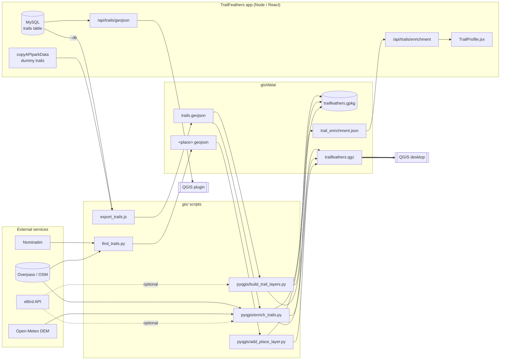
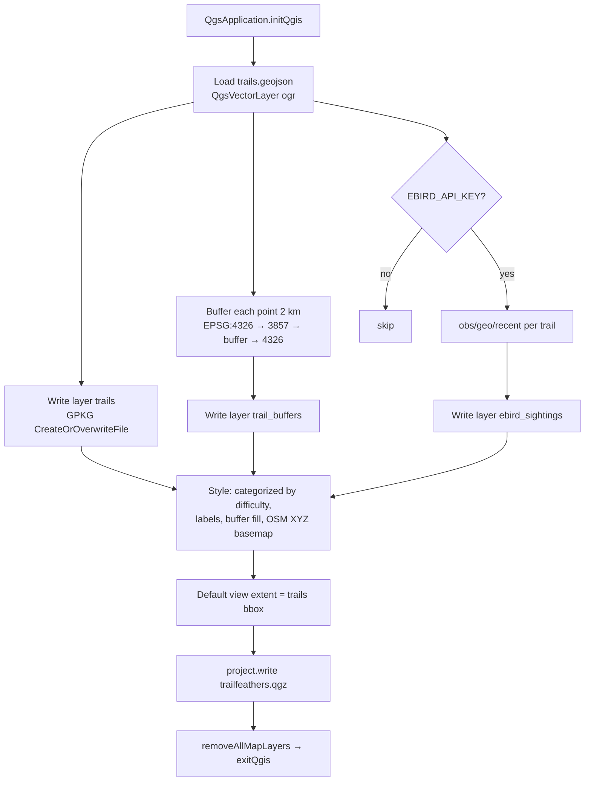
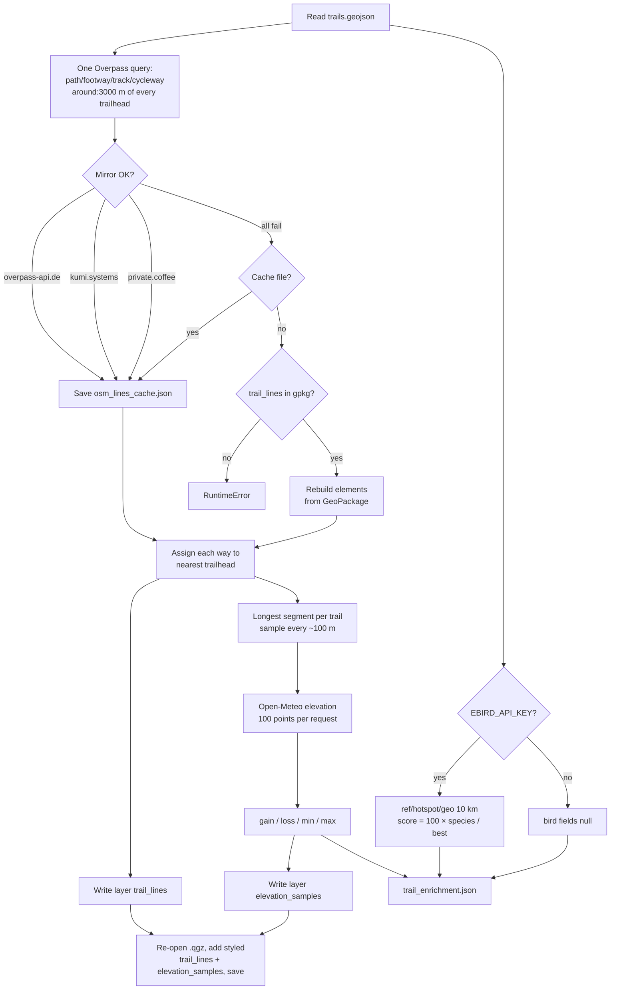
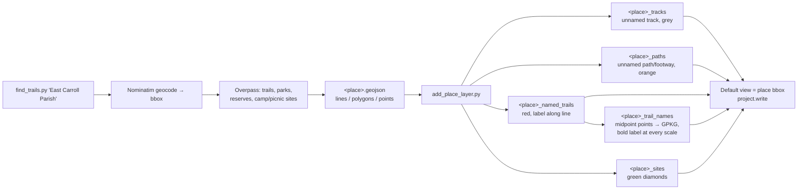
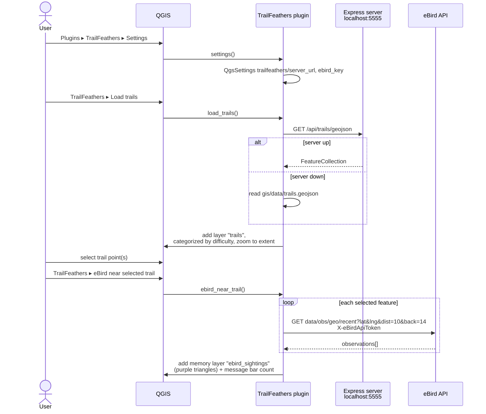

# TrailFeathers GIS (QGIS / PyQGIS)

Python tooling that turns the app's trail data into real GIS layers you can open, style and analyse in QGIS.

```
gis/
  export_trails.js                 Node: trails -> data/trails.geojson (dummy data or --db)
  pyqgis/build_trail_layers.py     Headless PyQGIS: GeoJSON -> GeoPackage + styled .qgz project
  qgis_plugin/trailfeathers/       QGIS plugin: load trails from the running server, eBird lookup
  data/                            generated outputs (trails.geojson, trailfeathers.gpkg, .qgz)
```

## How it fits together



Solid arrows are required inputs, dotted arrows need `EBIRD_API_KEY`. Every PyQGIS script runs
headless under `python-qgis-ltr.bat`, bootstraps `QgsApplication`, writes through
`QgsVectorFileWriter` into the shared GeoPackage, and saves the `.qgz` project so QGIS opens
straight onto the result.

## 1. Export trail data

```
node gis/export_trails.js        # uses copyAPIparkData dummy trails, no DB required
node gis/export_trails.js --db   # pulls from MySQL through the Sequelize model
```

## 2. Build the QGIS project (headless)



Requires QGIS installed via OSGeo4W (tested with QGIS 3.40 LTR).

```
C:\OSGeo4W\bin\python-qgis-ltr.bat gis\pyqgis\build_trail_layers.py
```

Produces `gis/data/trailfeathers.gpkg` with layers:

| layer            | geometry | notes                                             |
|------------------|----------|---------------------------------------------------|
| trails           | Point    | categorized by `difficulty`, labelled by name     |
| trail_buffers    | Polygon  | 2 km buffer around each trailhead (Web Mercator)  |
| ebird_sightings  | Point    | only when `EBIRD_API_KEY` is set                  |

and `gis/data/trailfeathers.qgz`, a ready-to-open project on an OpenStreetMap basemap.

To include recent eBird observations (last 14 days, 10 km around each trail):

```
set EBIRD_API_KEY=your_token      # https://ebird.org/api/keygen
C:\OSGeo4W\bin\python-qgis-ltr.bat gis\pyqgis\build_trail_layers.py
```

## 3. Enrich trails (OSM linework, elevation, bird score)



```
C:\OSGeo4Win\python-qgis-ltr.bat gis\pyqgis\enrich_trails.py
```

Adds two layers to the GeoPackage and project, and writes `gis/data/trail_enrichment.json`:

| layer / field       | source                                                        |
|---------------------|---------------------------------------------------------------|
| trail_lines         | OSM path/footway/track/cycleway ways within 3 km of each trailhead (Overpass) |
| elevation_samples   | points every ~100 m along the longest segment, elevation from Open-Meteo (SRTM/Copernicus DEM) |
| elev_gain_m etc.    | computed from the samples                                     |
| bird_score          | 0-100, scaled from all-time species count of the richest eBird hotspot within 10 km (needs `EBIRD_API_KEY`) |

The Express server exposes the JSON at `GET /api/trails/enrichment`, and the trail profile page shows it.

## 4. Find trails in a parish / county



No QGIS needed. Geocodes the place with Nominatim and pulls trails, parks, nature reserves and camp/picnic sites from OSM:

```
python gis/find_trails.py "East Carroll Parish" --state Louisiana
python gis/find_trails.py "Caddo Parish" --no-tracks     # drop farm/levee tracks
```

Output is `gis/data/<place>.geojson` (drag into QGIS) plus a printed table. To add it to the
TrailFeathers project as separate layers (named ways red with along-line labels, a `trail_names`
point layer that keeps every name visible at any scale, paths orange, tracks grey, sites green) and
make it the default view:

```
C:\OSGeo4Win\python-qgis-ltr.bat gis\pyqgisdd_place_layer.py gis\data\east_carroll_parish.geojson
```

Note the search uses the geocoded bounding box, so results near parish borders can spill into neighbours.

## 5. QGIS plugin



Copy (or symlink) `gis/qgis_plugin/trailfeathers` into your QGIS plugin folder, e.g.

```
%APPDATA%\QGIS\QGIS3\profiles\default\python\plugins\trailfeathers
```

then enable it in Plugins > Manage and Install Plugins. It adds three actions:

- **Load trails**: GET `/api/trails/geojson` from the running Express server (default `http://localhost:5555`), falling back to `gis/data/trails.geojson` if the server is down.
- **eBird near selected trail**: select one or more trail points, and the plugin adds a layer of recent eBird observations within 10 km.
- **Settings**: server URL and eBird API key.

## Server endpoint

`GET /api/trails/geojson` returns every row in the `trails` table as a GeoJSON FeatureCollection (added in `server/index.js`).

## Ideas for next steps

- Store enrichment in the `trails` table instead of a JSON file so it survives re-seeding.
- Swap Open-Meteo for USGS 3DEP (10 m) via the EPQS API for better Louisiana relief.
- Run the builder on a schedule and serve the GeoPackage as vector tiles with `tipg` or `pg_tileserv`.
- Render `trail_lines` in the React app with Leaflet so users see the actual route, not just a pin.
